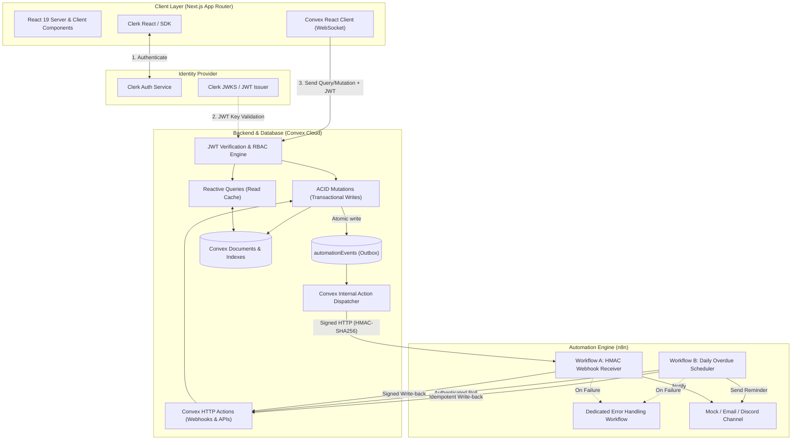
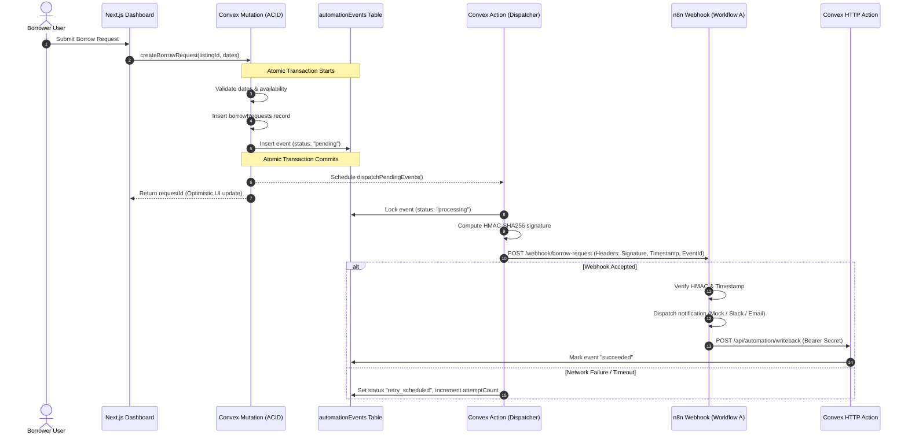
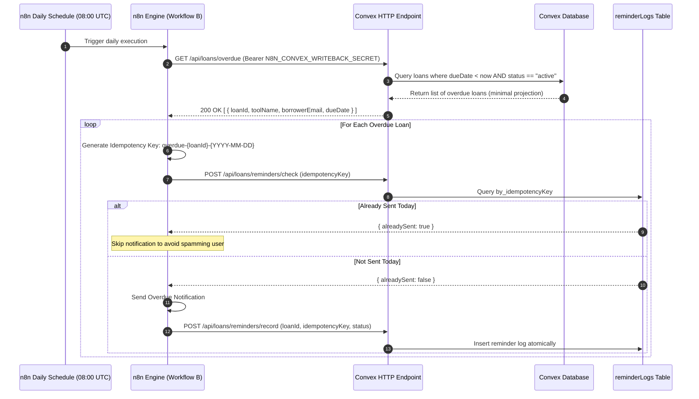

# LendLoop — System Architecture Specification

> **Document Status:** Active / Approved  
> **Target Audience:** Engineering Team & Technical Evaluators  
> **System Classification:** Distributed SaaS Architecture with Event-Driven Automation  

---

## 1. High-Level Architecture Overview

LendLoop adopts a modern decoupled architecture that separates the reactive client layer from the ACID transactional backend and the external automation pipeline.



---

## 2. Component Architecture

### 2.1 Frontend Architecture (Next.js App Router)
- **Framework:** Next.js 15+ using React 19 and TypeScript in strict mode.
- **Rendering Strategy:**
  - **Public Pages (`app/(public)`):** Server-rendered initial shell with client hydration for tool browsing and dynamic search/filtering.
  - **Authenticated Dashboard (`app/(dashboard)`):** Protected layout verifying Clerk authentication client and server-side. Real-time updates delivered via Convex's persistent WebSocket subscription.
  - **Admin Portal (`app/(dashboard)/admin`):** Protected route with double-enforced role verification (Clerk session + Convex server-side `requireAdmin` check).
- **Styling & Design System:**
  - Tailwind CSS with custom color tokens adhering to Apple-inspired minimalism (off-white `#F9FAFB`, deep slate `#111827`, deliberate subtle cobalt blue `#2563EB` accents).
  - Strictly follows `antislop` guidelines: zero generic purple-to-blue gradients, zero decorative floating orbs, zero fake testimonials or charts, WCAG AA compliance (contrast ratio >= 4.5:1), and minimum 44px tap targets.

### 2.2 Backend & Data Storage (Convex)
- **Transactional Consistency:** Every Convex mutation executes as a serializable, atomic transaction.
- **Data Isolation:** User emails and sensitive records are partitioned. Public queries only project non-sensitive tool listings and anonymized owner display names.
- **Indexing Strategy:** Every frequently filtered and joined relationship has an explicit index (e.g., `by_ownerId`, `by_status`, `by_category`, `by_idempotencyKey`).

### 2.3 Authentication & Authorization Layer
- **Clerk Identity:** Handles user sign-up, sign-in, multi-factor authentication, and user profile management.
- **Convex Auth Bridge:** Clerk issues JWTs signed with RS256; Convex validates the JWT using Clerk's `.well-known/jwks.json` endpoint configured in `convex/auth.config.ts`.
- **Server-Side RBAC Helpers:**
  - `requireAuthenticatedUser(ctx)`: Extracts verified identity subject (`clerkId`), maps to internal `users` document, or throws `UNAUTHENTICATED`.
  - `requireAdmin(ctx)`: Verifies user exists and has `role === 'admin'`.
  - `requireListingOwner(ctx, listingId)`: Verifies user identity matches `listing.ownerId`.
  - `requireBorrower(ctx, requestId)` / `requireLender(ctx, requestId)`: Verifies user identity against the request or loan participants.

---

## 3. Automation & Event Outbox Architecture

### 3.1 The Transactional Outbox Pattern
Directly invoking external HTTP webhooks from within a database mutation violates atomicity: network timeouts cause rollbacks or duplicate webhook triggers.

LendLoop implements a reliable **Transactional Outbox Pattern**:
1. When a business mutation occurs (e.g., `createBorrowRequest`, `approveBorrowRequest`), the mutation writes the business entity **and** an event record into `automationEvents` inside the exact same atomic transaction.
2. The mutation schedules an internal Convex action (`dispatchPendingEvents`).
3. The Convex action loads pending events from `automationEvents`, signs each payload with HMAC SHA-256, and dispatches them via HTTP POST to the n8n webhook URL.
4. If dispatch succeeds, the event state transitions to `succeeded`.
5. If the network call fails or times out, the event state transitions to `retry_scheduled` with an exponential backoff timestamp (`nextRetryAt = now + (2^attempt * 30s)`).
6. A scheduled cleanup cron runs every 15 minutes to recover any events left in `processing` state for longer than 5 minutes.



---

## 4. Webhook Security & Integrity Protocols

### 4.1 Convex to n8n (Outbound)
- **Signature Algorithm:** HMAC SHA-256 using a shared secret (`CONVEX_N8N_HMAC_SECRET`).
- **Signature Payload:** A deterministic string concatenation:
  `canonicalPayload = timestamp + "." + eventId + "." + rawBodyJSON`
- **Headers Transmitted:**
  - `X-LendLoop-Signature`: Hex-encoded HMAC hash.
  - `X-LendLoop-Timestamp`: Unix epoch milliseconds.
  - `X-LendLoop-Event-Id`: Unique UUID string.
- **n8n Verification Checks:**
  1. Signature recalculation matches `X-LendLoop-Signature` using constant-time comparison.
  2. Timestamp freshness check: `|currentTime - X-LendLoop-Timestamp| < 300,000 ms` (5-minute tolerance window).
  3. Replay attack prevention: n8n stores or verifies `eventId` has not been processed within the freshness window.

### 4.2 n8n to Convex (Inbound Write-Back)
- **Endpoint:** `POST https://<convex-site-url>/api/automation/writeback`
- **Authentication:** `Authorization: Bearer <N8N_CONVEX_WRITEBACK_SECRET>`
- **Validation:** Convex HTTP Action checks the Bearer token, parses the validated payload, and invokes an internal mutation `recordAutomationWriteback` to update `automationEvents` and record audit logs.

---

## 5. Overdue Reminder Architecture (Workflow B)



---

## 6. Directory Structure Blueprint

```
lendloop/
├── app/
│   ├── (auth)/
│   │   ├── sign-in/[[...sign-in]]/page.tsx
│   │   └── sign-up/[[...sign-up]]/page.tsx
│   ├── (dashboard)/
│   │   ├── admin/
│   │   │   └── page.tsx
│   │   ├── dashboard/
│   │   │   └── page.tsx
│   │   ├── listings/
│   │   │   ├── [id]/page.tsx
│   │   │   └── new/page.tsx
│   │   └── layout.tsx
│   ├── (public)/
│   │   ├── page.tsx
│   │   └── tools/page.tsx
│   ├── api/
│   ├── layout.tsx
│   └── globals.css
├── components/
│   ├── admin/
│   │   ├── AdminLoanTable.tsx
│   │   └── TrustedLenderToggle.tsx
│   ├── dashboard/
│   │   ├── BorrowRequestsList.tsx
│   │   ├── LoanHistoryTable.tsx
│   │   ├── MyListingsGrid.tsx
│   │   └── ToolDirectory.tsx
│   ├── listings/
│   │   ├── BorrowModal.tsx
│   │   ├── ListingCard.tsx
│   │   └── ListingForm.tsx
│   ├── shared/
│   │   ├── EmptyState.tsx
│   │   ├── ErrorBoundary.tsx
│   │   ├── Footer.tsx
│   │   ├── LoadingSkeleton.tsx
│   │   └── Navbar.tsx
│   └── ui/
│       ├── Badge.tsx
│       ├── Button.tsx
│       ├── Dialog.tsx
│       ├── Input.tsx
│       ├── Select.tsx
│       └── Toast.tsx
├── convex/
│   ├── auth.config.ts
│   ├── automation.ts
│   ├── http.ts
│   ├── lib/
│   │   ├── auth.ts
│   │   ├── crypto.ts
│   │   └── dates.ts
│   ├── listings.ts
│   ├── loans.ts
│   ├── requests.ts
│   ├── schema.ts
│   └── users.ts
├── docs/
│   ├── ARCHITECTURE.md
│   ├── DATA-MODEL.md
│   ├── PRODUCTION-READINESS.md
│   ├── PROJECT-PLAN.md
│   ├── SECURITY.md
│   └── THREAT-MODEL.md
├── n8n/
│   ├── README.md
│   └── workflows/
│       ├── error-handler.json
│       ├── overdue-reminders.json
│       └── request-notification.json
├── tests/
│   ├── e2e/
│   │   ├── 01-public-browse.spec.ts
│   │   ├── 02-auth-gate.spec.ts
│   │   ├── 03-listing-lifecycle.spec.ts
│   │   ├── 04-borrow-workflow.spec.ts
│   │   ├── 05-loan-return.spec.ts
│   │   ├── 06-rbac-isolation.spec.ts
│   │   ├── 07-admin-operations.spec.ts
│   │   └── 08-overdue-automation.spec.ts
│   ├── integration/
│   │   ├── auth.test.ts
│   │   ├── listings.test.ts
│   │   └── requests.test.ts
│   └── unit/
│       ├── crypto.test.ts
│       ├── dates.test.ts
│       └── idempotency.test.ts
├── .env.example
├── docker-compose.yml
├── next.config.ts
├── package.json
├── playwright.config.ts
├── README.md
├── tailwind.config.ts
└── tsconfig.json
```
