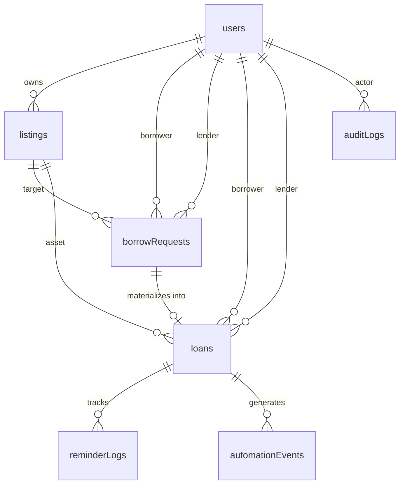

# LendLoop — Data Model & Schema Specification

> **Database System:** Convex Cloud (Document-Relational Engine)  
> **Schema Definition File:** `convex/schema.ts`  
> **Integrity Model:** ACID Transactions, Strict TypeScript Types, Indexed Relational Joins  

---

## 1. Entity-Relationship Overview



---

## 2. Table Specifications & Indexes

### 2.1 Table: `users`
Represents synchronized user profiles linked to Clerk subjects.

| Field Name | Type | Constraints | Description |
|---|---|---|---|
| `_id` | `Id<"users">` | Primary Key | Convex internal document ID |
| `clerkId` | `string` | Unique, Required | Clerk Subject ID (`user_2...`) |
| `name` | `string` | Required | User's full or display name |
| `email` | `string` | Required, Internal | User's verified email address |
| `role` | `"user" \| "admin"` | Default `"user"` | Server-enforced role |
| `isTrustedLender` | `boolean` | Default `false` | Conferred by admin to highlight reliable lenders |
| `avatarUrl` | `optional(string)` | | Optional profile avatar URL |
| `createdAt` | `number` | Required | Unix epoch timestamp (ms) |
| `updatedAt` | `number` | Required | Unix epoch timestamp (ms) |

**Indexes:**
- `by_clerkId` on `["clerkId"]`: Used on every authenticated request to map Clerk JWT identity to Convex internal user ID.
- `by_role` on `["role"]`: Used by admin management queries.

---

### 2.2 Table: `listings`
Represents tools published for neighborhood borrowing.

| Field Name | Type | Constraints | Description |
|---|---|---|---|
| `_id` | `Id<"listings">` | Primary Key | Convex internal document ID |
| `ownerId` | `Id<"users">` | Foreign Key | Reference to `users._id` |
| `name` | `string` | Required (1-100 chars) | Tool name (e.g., "DeWalt 20V Cordless Drill") |
| `category` | `string` | Enum / Categorized | "Power Tools", "Hand Tools", "Lawn & Garden", "Plumbing", "Electrical", "Woodworking", "Automotive", "Other" |
| `condition` | `string` | Enum | "Brand New", "Like New", "Good Condition", "Fair / Functional" |
| `description` | `string` | Required (1-500 chars) | Short description of tool, included accessories, or usage rules |
| `isAvailable` | `boolean` | Default `true` | Dynamic availability state; toggled `false` when active loan starts |
| `isRemoved` | `boolean` | Default `false` | Soft-delete flag (allows historic loan tracking even if removed) |
| `createdAt` | `number` | Required | Unix epoch timestamp (ms) |
| `updatedAt` | `number` | Required | Unix epoch timestamp (ms) |

**Indexes:**
- `by_ownerId` on `["ownerId"]`: Fast retrieval of user's listed tools ("My Listings").
- `by_category_available` on `["category", "isAvailable", "isRemoved"]`: Fast public directory browsing and filtering.
- `by_isAvailable` on `["isAvailable", "isRemoved"]`: Fast catalog queries.

---

### 2.3 Table: `borrowRequests`
Represents an intention by a user to borrow a tool for a specific date window.

| Field Name | Type | Constraints | Description |
|---|---|---|---|
| `_id` | `Id<"borrowRequests">` | Primary Key | Convex internal document ID |
| `listingId` | `Id<"listings">` | Foreign Key | Reference to `listings._id` |
| `borrowerId` | `Id<"users">` | Foreign Key | User requesting the tool |
| `lenderId` | `Id<"users">` | Foreign Key | Owner of the requested tool |
| `startDate` | `string` | ISO 8601 Date (`YYYY-MM-DD`) | Borrow start date (inclusive) |
| `endDate` | `string` | ISO 8601 Date (`YYYY-MM-DD`) | Borrow return due date (inclusive) |
| `status` | `string` | Enum | `"pending" \| "approved" \| "declined" \| "cancelled"` |
| `note` | `optional(string)` | Max 250 chars | Optional note from borrower to lender |
| `createdAt` | `number` | Required | Unix epoch timestamp (ms) |
| `updatedAt` | `number` | Required | Unix epoch timestamp (ms) |

**Indexes:**
- `by_listingId` on `["listingId", "status"]`: Check existing requests for a tool.
- `by_borrowerId` on `["borrowerId", "status"]`: "My Requests" tab in dashboard.
- `by_lenderId` on `["lenderId", "status"]`: "Incoming Requests" tab in dashboard.

---

### 2.4 Table: `loans`
Materialized agreement created when a lender approves a borrow request.

| Field Name | Type | Constraints | Description |
|---|---|---|---|
| `_id` | `Id<"loans">` | Primary Key | Convex internal document ID |
| `listingId` | `Id<"listings">` | Foreign Key | Reference to `listings._id` |
| `requestId` | `Id<"borrowRequests">` | Foreign Key | Reference to originating `borrowRequests._id` |
| `borrowerId` | `Id<"users">` | Foreign Key | User who borrowed the tool |
| `lenderId` | `Id<"users">` | Foreign Key | Tool owner |
| `startDate` | `string` | ISO 8601 Date | Scheduled start date |
| `dueDate` | `string` | ISO 8601 Date | Scheduled due date |
| `returnedAt` | `optional(number)` | Timestamp (ms) | Timestamp when returned |
| `status` | `string` | Enum | `"active" \| "returned" \| "overdue"` |
| `createdAt` | `number` | Required | Unix epoch timestamp (ms) |
| `updatedAt` | `number` | Required | Unix epoch timestamp (ms) |

**Indexes:**
- `by_borrowerId` on `["borrowerId", "status"]`: Borrower loan tracking.
- `by_lenderId` on `["lenderId", "status"]`: Lender loan tracking.
- `by_listingId` on `["listingId", "status"]`: Check active loan for tool.
- `by_status_dueDate` on `["status", "dueDate"]`: Optimized query for scheduled overdue reminder processor.

---

### 2.5 Table: `automationEvents` (Transactional Outbox)
Stores event payloads to be dispatched to n8n reliably without network coupling.

| Field Name | Type | Constraints | Description |
|---|---|---|---|
| `_id` | `Id<"automationEvents">` | Primary Key | Convex internal document ID |
| `eventId` | `string` | Unique UUID v4 | Stable idempotency & trace identifier |
| `eventType` | `string` | Enum | `"request.created" \| "request.status_changed" \| "loan.created" \| "loan.returned"` |
| `targetEntityId` | `string` | Entity ID | ID of the request, loan, or listing |
| `payload` | `any` | Validated JSON object | Minimal required event payload |
| `status` | `string` | Enum | `"pending" \| "processing" \| "succeeded" \| "failed" \| "retry_scheduled"` |
| `attemptCount` | `number` | Default `0` | Number of dispatch attempts |
| `nextRetryAt` | `number` | Timestamp (ms) | Earliest time for next retry attempt |
| `lastError` | `optional(string)` | Error message | Sanitized error log from failed attempt |
| `createdAt` | `number` | Timestamp (ms) | Creation time |
| `updatedAt` | `number` | Timestamp (ms) | Last status update |

**Indexes:**
- `by_eventId` on `["eventId"]`: Fast lookup by UUID.
- `by_status_nextRetry` on `["status", "nextRetryAt"]`: Fast query for outbox dispatcher cron.

---

### 2.6 Table: `reminderLogs`
Enforces database-level idempotency for daily overdue reminders.

| Field Name | Type | Constraints | Description |
|---|---|---|---|
| `_id` | `Id<"reminderLogs">` | Primary Key | Convex internal document ID |
| `loanId` | `Id<"loans">` | Foreign Key | Reference to `loans._id` |
| `reminderType` | `string` | Default `"overdue"` | Type of reminder |
| `dueDate` | `string` | ISO 8601 Date | Due date referenced |
| `idempotencyKey` | `string` | Unique | Deterministic string: `overdue-{loanId}-{YYYY-MM-DD}` |
| `deliveryStatus` | `string` | Enum | `"sent" \| "failed"` |
| `timestamp` | `number` | Timestamp (ms) | Delivery execution time |

**Indexes:**
- `by_idempotencyKey` on `["idempotencyKey"]`: Enforces zero duplicate daily reminders even during network retries.
- `by_loanId` on `["loanId"]`: Loan detail activity history.

---

### 2.7 Table: `auditLogs`
Immutable security and administrative audit trail.

| Field Name | Type | Constraints | Description |
|---|---|---|---|
| `_id` | `Id<"auditLogs">` | Primary Key | Convex internal document ID |
| `actorId` | `string` | Clerk ID or `"system"` | Actor who performed the action |
| `action` | `string` | Action name | e.g. `"admin.remove_listing"`, `"admin.set_trusted_lender"` |
| `targetEntity` | `string` | Entity identifier | Table name and document ID |
| `metadata` | `any` | JSON | Additional audit metadata |
| `timestamp` | `number` | Timestamp (ms) | Log creation timestamp |

**Indexes:**
- `by_actorId` on `["actorId"]`: Filter audit trail by operator.
- `by_targetEntity` on `["targetEntity"]`: Filter audit trail by resource.

---

## 3. State Machines & Concurrency Invariants

### 3.1 Borrow Request State Machine
```
[User Submits Request]
       │
       ▼
   (pending) ───[Borrower Cancels]───► (cancelled)
       │
       ├──[Lender Approves]───► (approved) ──► [Creates Loan] & [Declines Overlapping Requests]
       │
       └──[Lender Declines]───► (declined)
```

**Concurrency Protection:**
When a lender calls `approveBorrowRequest(requestId)`:
1. An atomic Convex mutation begins.
2. The mutation verifies the listing is still available.
3. The mutation sets `request.status = "approved"`.
4. The mutation creates a new document in `loans` with `status: "active"`.
5. The mutation sets `listing.isAvailable = false`.
6. The mutation finds any other pending requests for the same listing that overlap with the approved date window and automatically marks them `declined` with reason: `"Dates no longer available"`.
7. The mutation inserts `request.status_changed` and `loan.created` events into `automationEvents`.
8. The transaction commits atomically, completely preventing race conditions.

### 3.2 Loan Lifecycle State Machine
```
   [Request Approved]
          │
          ▼
      (active)
          │
          ├──[Due Date Passes]──► (overdue) ──► [n8n Daily Reminders]
          │                                           │
          └──[Returned] ◄─────────────────────────────┘
                 │
                 ▼
          (returned) ──► [Listing Marked Available]
```
